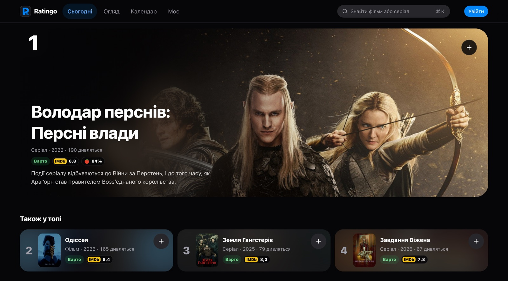

<div align="center">

<h1>&nbsp;Ratingo</h1>

What to watch tonight, and when the next episode is out. In Ukrainian.

**[ratingo.top](https://ratingo.top)**

<br />

<a href="https://ratingo.top"></a>

</div>

Hi, I'm Eugene. Frontend at monobank; before that, tech lead at Silpo and Rozetka, plus stints at Mastercard and EA, where I worked on Battlelog.

I watch a lot of TV shows and kept losing track of them. Which episode was I on, when does the next season start, is this new thing any good or just loud marketing. IMDb, Trakt and TV Time each cover a piece of it. None of them in Ukrainian.

So in November 2025 I started building my own. A year and about 1,400 commits later, people use it every day. Not many yet, but they keep coming back.

## What you can do there

- See what people are watching this week, with TMDB, Trakt, IMDb and Metacritic ratings next to each other
- Keep a list of what you watch, plan to watch and gave up on
- Tick off episodes and get a calendar of the ones coming up
- Get a reminder when your show has a new episode
- Install it on your phone like an app

## Inside

```
apps/api          NestJS, Fastify, Drizzle, PostgreSQL, BullMQ
apps/storefront   Next.js 16, React 19, TanStack Query
```

It started as a weekend project and turned into the place where I try things I don't get to try at work. A few I'm happy with:

- Nobody picks titles for the catalog by hand. A set of plain functions decides, and every "no" comes with a reason, so I can always see why something is missing.
- A classic with 200k votes and a show that came out on Friday get one comparable number, the Ratingo Score.
- Each data provider has its own queue. When Trakt rate-limits me, TMDB sync keeps going.
- The API domain code doesn't know Nest or Drizzle exist, so it's tested without a database.

It runs on Railway, metrics go to Grafana, and Postgres gets backed up every night. The domain once expired and the site went dark for a day, so now I have a reminder for that too.

## Run it yourself

```bash
git clone https://github.com/eurusik/ratingo.git && cd ratingo
npm install
docker-compose up -d                  # Postgres + Redis
cp apps/api/.env.example apps/api/.env   # add your TMDB, Trakt and OMDb keys
npm run db:migrate --workspace=api
npm run dev:api                       # localhost:3001
npm run dev:storefront                # localhost:3003
```

## Help make it better

I'd really appreciate your help making Ratingo better. Spotted a bug, or something feels off or missing? [Open an issue](https://github.com/eurusik/ratingo/issues/new) and describe what happened. I'll pick it up, and once it's fixed I'll reply there so you know.

And if you just like it, a star tells me I'm not the only one.

MIT licensed.

<p align="center">Made in Ukraine 🇺🇦 💙💛</p>
